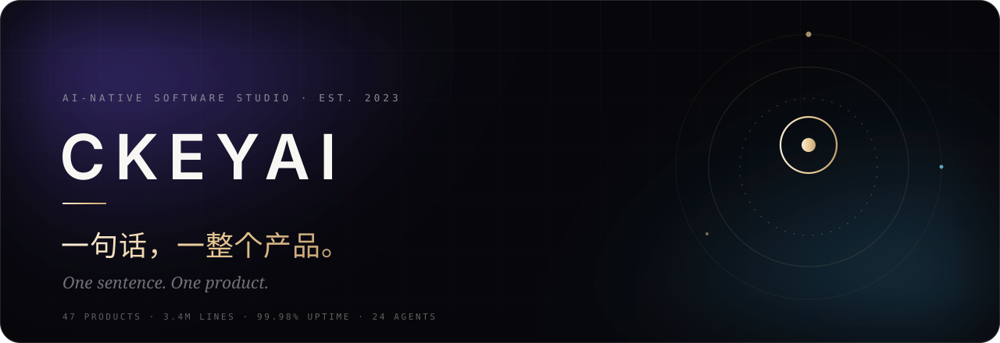
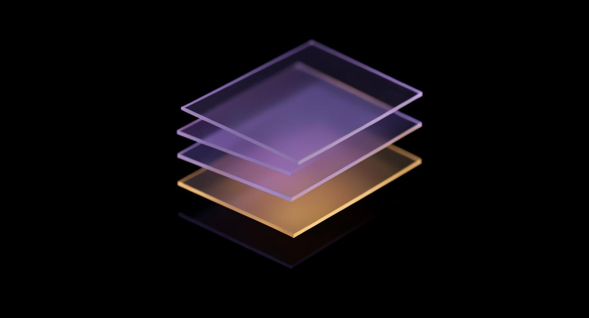
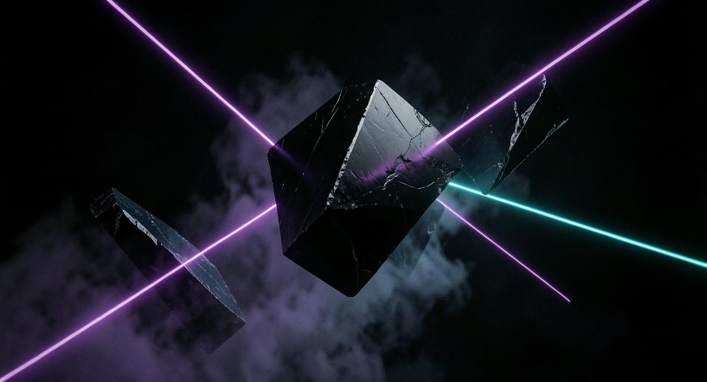

  

   

  
  
  
  

 

### 人类负责品味，智能体负责工程量。

CKEYAI 是一家 AI 原生软件工作室：一个人，二十四位常驻智能体。从一句自然语言出发，完成设计、架构、编码、测试与部署——把「想法」直接编译成「上线」。

 

| 交付产品 | 生成代码 | 可用性 | 团队杠杆 | P0 事故 |
| :---: | :---: | :---: | :---: | :---: |
| **47** | **3.4M** | **99.98%** | **12×** | **0** |

 

## 精选作品

<table>
  <tr>
    <td width="50%" valign="top">
      
        
      <b>NEBULA</b> · AI 原生工作台 
      给独立创始人的操作系统 — Product Hunt #1 · 30 天 2.3k 用户
    </td>
    <td width="50%" valign="top">
      
        
      <b>LUMEN</b> · 生成式设计系统 
      一句话交付品牌规范与组件库 — 1,400 个团队 · 3 个月 → 4 小时
    </td>
  </tr>
  <tr>
    <td width="50%" valign="top">
      
        
      <b>ATLAS</b> · 自主运维智能体 
      托管 1,480 个服务 — MTTR 38 秒 · P0 事故 0 起
    </td>
    <td width="50%" valign="top">
      
        
      <b>ORBIT</b> · 一句话 SaaS 引擎 
      从描述到可运营的 SaaS — 32k 开发者 · 8,900 个项目
    </td>
  </tr>
</table>

 

## 智能体团队

> 二十四位常驻智能体，共享同一套记忆、规范与权限边界。没有会议，没有交接。

| 代号 | 职能 | 战绩 |
| :-- | :-- | --: |
| `PRISM` | 设计与品牌 | 1,942 个界面 |
| `ARCHITECT` | 架构与契约 | 318 个系统 |
| `FORGE` | 实现 | 12,847 个 PR |
| `SENTRY` | 质量 | 4,109 个缺陷 |
| `ORACLE` | 数据与洞察 | 2,600 次实验 |
| `MUSE` | 叙事与内容 | 1.2M 字 |

## 轨迹

| 时间 | 事件 |
| :-- | :-- |
| 2023.04 | 工作室成立，第一行代码由智能体提交 |
| 2024.02 | 第一套智能体工作流，交付速度 ×9 |
| 2024.11 | NEBULA 登顶 Product Hunt |
| 2025.02 | GitHub Trending 全球第一 |
| 2026.06 | 第 100 万次生产部署 |
| 2026.11 | 获评年度 AI 原生工作室 |

## 荣誉

- **Studio of the Year** — AI Engineering Awards · 2026
- **Most Creative People** 提名 — Fast Company · 2026
- **Golden Kitty Awards** 提名 — Product Hunt · 2026
- **Site of the Day** — Awwwards · 2025

 

  <b>把下一个想法，交给一句话。</b>
    
  
  
    
  © 2026 CKEYAI STUDIO · 上海 / 远程 · 内容为概念品牌叙事

